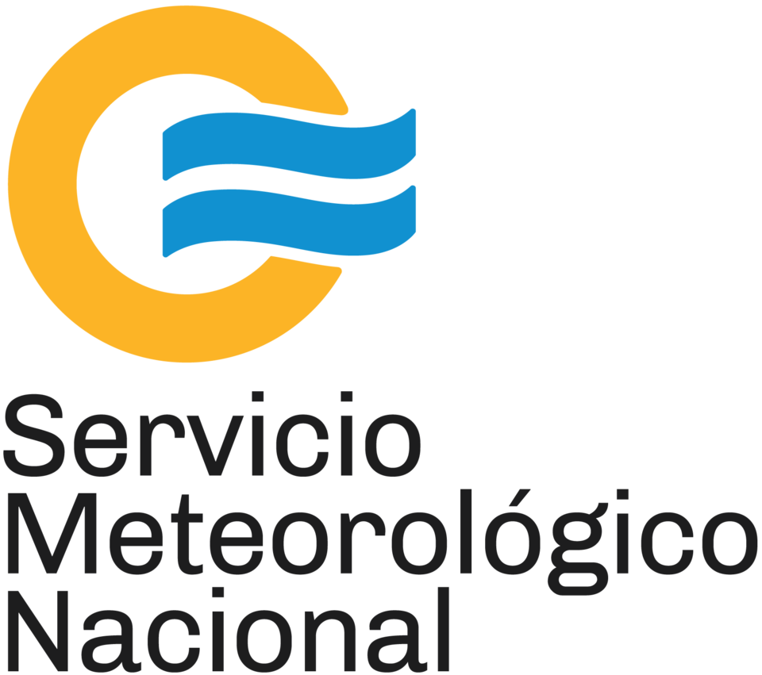

<p align="center">
  
</p>

# Servicio Meteorológico Nacional (SMN Argentina) para Home Assistant

Integración para Home Assistant que ofrece el estado del tiempo y pronóstico del Servicio Meteorológico Nacional (SMN) argentino.

[](https://github.com/hacs/default)
[](https://github.com/Lean724/SMNAR_HA/releases)
[](LICENSE)
[](https://github.com/Lean724/SMNAR_HA/actions)
[](https://github.com/Lean724/SMNAR_HA/actions)

---

## Características

* **Entidad de Clima (`weather`)**: Cumple con los estándares actuales de Home Assistant con soporte de pronóstico diario y horario (`async_forecast_daily` y `async_forecast_hourly`).
* **Condiciones en Tiempo Real**:
  * Temperatura actual (°C).
  * Sensación térmica (°C).
  * Humedad relativa (%).
  * Presión atmosférica al nivel de la estación (hPa).
  * Viento (velocidad en km/h, dirección y grados).
  * Visibilidad (km).
  * Condición meteorológica oficial con icono dinámico.
* **Pronóstico Extendido a 5 Días**:
  * Pronóstico horario (cada 3 horas): temperatura, precipitación acumulada (mm), viento y condición.
  * Pronóstico diario: temperaturas máximas y mínimas estimadas, precipitación total estimada y condición predominante.
* **Cobertura Nacional**: Más de 118 estaciones meteorológicas oficiales en todas las provincias de Argentina y bases antárticas.
* **Detección Automática de Cercanía**: Calcula por geolocalización (fórmula Haversine) la estación oficial más cercana a las coordenadas de Home Assistant.
* **Sensores Individuales**: 8 entidades tipo `sensor` independientes para Temperatura, Sensación Térmica, Humedad, Presión, Velocidad del Viento, Dirección del Viento, Visibilidad y Condición Actual para tableros y automatizaciones.
* **Conexión Directa y Confiable**: Consume los datos oficiales abiertos del SMN sin necesidad de claves de acceso, tokens temporales ni intermediarios.
* **Configuración Gráfica**: Config Flow y Options Flow para instalar y modificar la estación o frecuencia de actualización desde la interfaz.

---

## Instalación

### Método 1: Mediante HACS (Recomendado)

1. Abre **Home Assistant** y entra en **HACS**.
2. En la sección **Integraciones**, abre el menú de tres puntos (arriba a la derecha) y selecciona **Repositorios personalizados**.
3. Ingresa los siguientes datos:
   * **Repositorio**: `https://github.com/Lean724/SMNAR_HA`
   * **Tipo**: `Integración`
4. Haz clic en **Añadir**.
5. Busca **Servicio Meteorológico Nacional (SMN Argentina)** y pulsa en **Descargar**.
6. Reinicia Home Assistant.

### Método 2: Instalación Manual

1. Descarga el repositorio como archivo ZIP.
2. Copia la carpeta `custom_components/smn_ar` dentro del directorio `custom_components/` de tu instalación de Home Assistant:
   ```text
   config/
   └── custom_components/
       └── smn_ar/
           ├── __init__.py
           ├── config_flow.py
           ├── const.py
           ├── coordinator.py
           ├── manifest.json
           ├── sensor.py
           ├── stations.json
           ├── strings.json
           ├── weather.py
           └── translations/
   ```
3. Reinicia Home Assistant.

---

## Configuración

1. En Home Assistant, dirígete a **Ajustes** -> **Dispositivos y servicios** -> **Añadir integración**.
2. Busca **Servicio Meteorológico Nacional (Argentina)**.
3. El asistente preseleccionará la estación más cercana según las coordenadas de tu hogar. Puedes confirmarla o seleccionar cualquier otra estación de la lista.
4. Define el intervalo de actualización deseado (por defecto: 1800 segundos / 30 minutos).
5. Confirma para crear el dispositivo con su entidad de clima y sensores asociados.

> Para cambiar la estación o el intervalo más adelante, accede a **Ajustes** -> **Dispositivos y servicios** -> **SMN Argentina** -> **Configurar**.

---

## Entidades Generadas

| Plataforma | Identificador | Descripción |
| :--- | :--- | :--- |
| `weather` | `weather.smn_<estacion>` | Entidad de clima principal con pronóstico horario y diario |
| `sensor` | `sensor.smn_<estacion>_temperatura` | Temperatura ambiente (°C) |
| `sensor` | `sensor.smn_<estacion>_sensacion_termica` | Sensación térmica (°C) |
| `sensor` | `sensor.smn_<estacion>_humedad` | Humedad relativa (%) |
| `sensor` | `sensor.smn_<estacion>_presion_atmosferica` | Presión atmosférica (hPa) |
| `sensor` | `sensor.smn_<estacion>_velocidad_del_viento` | Velocidad del viento (km/h) |
| `sensor` | `sensor.smn_<estacion>_direccion_del_viento` | Dirección cardinal del viento (ej. Noreste) |
| `sensor` | `sensor.smn_<estacion>_visibilidad` | Visibilidad (km) |
| `sensor` | `sensor.smn_<estacion>_condicion_actual` | Descripción oficial del estado del cielo |

---

## Ejemplos en el Tablero (Lovelace)

### Tarjeta de Clima Estándar (Pronóstico Diario)

```yaml
type: weather-forecast
entity: weather.smn_aeroparque_aero
forecast_type: daily
name: SMN Aeroparque
```

### Tarjeta con Pronóstico Horario

```yaml
type: weather-forecast
entity: weather.smn_aeroparque_aero
forecast_type: hourly
name: SMN Pronóstico por Horas
```

---

## Fuente de Datos y Atribución

Los datos meteorológicos son provistos por el **Servicio Meteorológico Nacional** de la República Argentina a través de su plataforma de datos abiertos.

Este desarrollo es una integración comunitaria de código abierto para Home Assistant y no posee afiliación oficial con el Servicio Meteorológico Nacional.

---

## Licencia

Este proyecto se distribuye bajo la Licencia **MIT**. Consulta el archivo [LICENSE](LICENSE) para más información.
